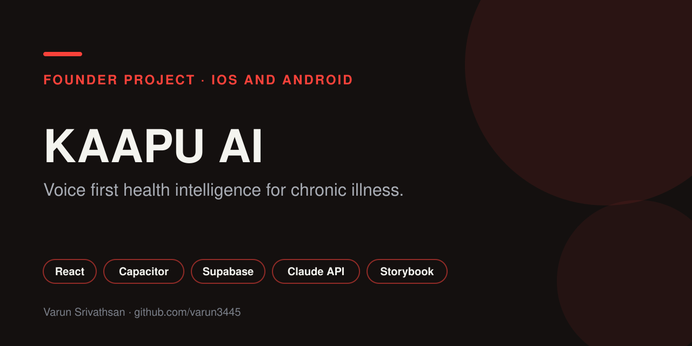

<p align="center"></p>

# Kaapu AI

A voice first health app for people living with chronic illness. Log symptoms by talking, map pain in 3D, share updates with family, and trigger emergency help with one tap.

Founded and built solo by [Varun Srivathsan](https://varunsrivathsan.com). Ranked in the top 10 on PeerPush.

    

Live: [kaapu-ai.vercel.app](https://kaapu-ai.vercel.app) · Landing page: [`kaapu-landing`](https://github.com/varun3445/kaapu-landing)

## Features

| Area | What it does |
| --- | --- |
| Voice and chat | Conversational logging and health Q&A (`pages/AI.jsx`), with ElevenLabs voice through edge functions |
| 3D pain mapping | Tap a body model to record where it hurts (`pages/BodyMap.jsx`, Three.js) |
| Conditions and medication | Condition tracking, medication reminders, drug information |
| Family and doctor sharing | Family circle and a doctor portal for sharing history |
| Emergency | SOS flow with push, SMS and phone call through Twilio backed edge functions |
| Insights | Weekly summaries generated by an LLM, charts with Recharts |
| Device health data | HealthKit and Health Connect through Capacitor |

## Safety and evaluation

Health answers are grounded and tested, not left to chance.

- **Agent skills** in `agent/skills/`: emergency detection, symptom triage, medication safety, medical knowledge search.
- **Knowledge base** in `knowledge-base/`: NHS condition pages and MHRA drug safety notices, ingested with `ingest.py`.
- **Evals** in `eval/`: HealthBench samples, medication safety retests, and baseline versus after skills runs, with scripts to reproduce them.

## Architecture

```
React + Vite (Capacitor shell for iOS and Android)
        |
Supabase  (auth, Postgres, row level security)
        |
Edge functions  kaapu-chat, kaapu-elevenlabs-llm, kaapu-weekly-insight,
                med-info, med-reminders, make-emergency-call,
                send-emergency-sms, send-emergency-push, send-welcome-email
        |
Claude API  +  ElevenLabs
```

## Design system

Design tokens live in `tokens/tokens.json`. Components are documented in Storybook with accessibility checks and visual regression through Chromatic (`.github/workflows/chromatic.yml`).

## Stack

React 18, Vite, Tailwind CSS 3, Framer Motion, Three.js with react three fiber, Recharts, React Router, Capacitor 8, Supabase, Claude API, ElevenLabs, Storybook 10, Vitest with Playwright, MSW.

## Run it locally

```bash
cp .env.example .env.local     # add Supabase values
npm install
npm run dev
npm run storybook              # component workshop on :6006
```

## Author

[Varun Srivathsan](https://varunsrivathsan.com).
